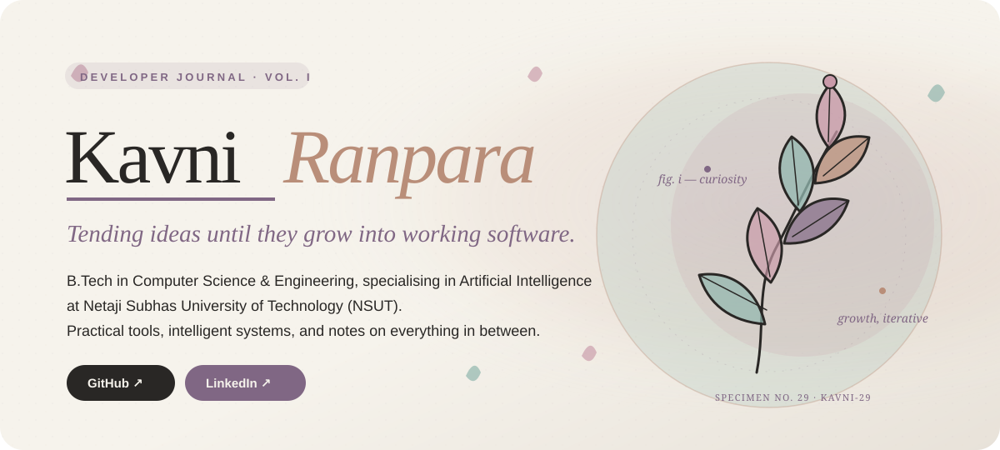

  

<a href="https://github.com/kavni-29">GitHub ↗</a> &nbsp; · &nbsp; <a href="https://www.linkedin.com/in/kavni-ranpara-b342a9343/">LinkedIn ↗</a> &nbsp; · &nbsp; <a href="assets/hero/botanical-loop.gif">Animated botanical study</a>

---

## § 01 — About

I’m drawn to the space where technical exploration, practical engineering, and creative thinking meet. My interests span artificial intelligence and machine learning, software engineering, web development, and useful systems tools—approached with curiosity and a designer’s eye.

## § 02 — Project exhibits

<table>
  <tr>
    <td width="50%" valign="top">
      
NO. 01 &nbsp; SYSTEMS · NETWORKING

      <h3><a href="https://github.com/kavni-29/netscope">NetScope ↗</a></h3>
      
      
A Python tool for analysing saved PCAP/PCAPNG captures—aggregating bidirectional flows, summarising traffic statistics, and surfacing explainable, rule-based anomalies through command-line and desktop interfaces.

      
Python · Scapy · Tkinter · Matplotlib · NumPy

    </td>
    <td width="50%" valign="top">
      
NO. 02 &nbsp; WEB · USABILITY RESEARCH

      <h3><a href="https://github.com/kavni-29/USABILITY-HUB-CLONE">Usability Hub Clone ↗</a></h3>
      
      
A Flask research platform for creating and sharing usability studies, collecting participant responses without requiring accounts, and reviewing results through charts and CSV exports.

      
Python · Flask · SQLAlchemy · SQLite / PostgreSQL · HTML · CSS

    </td>
  </tr>
</table>

Project artwork is illustrative, not a product screenshot.

## § 03 — Skills, catalogued

<table>
  <tr>
    <td width="50%" valign="top">
      <h3>Languages</h3>
      
Python · C · C++ · Java · JavaScript · SQL

    </td>
    <td width="50%" valign="top">
      <h3>AI/ML &amp; data</h3>
      
Machine-learning fundamentals · Data visualisation

    </td>
  </tr>
  <tr>
    <td width="50%" valign="top">
      <h3>Software &amp; web</h3>
      
HTML · CSS · Backend / APIs · Databases · Deployment

    </td>
    <td width="50%" valign="top">
      <h3>Tools</h3>
      
Git · GitHub · Visual Studio Code

    </td>
  </tr>
</table>

## § 04 — Research &amp; learning

I treat learning as an ongoing experiment: reading closely, building small, and revisiting ideas until they make sense from the inside.

<strong>Currently exploring</strong> AI/ML foundations · Software engineering practice · Research methods

## § 05 — Margins

Off the keyboard, you’ll find me journalling, writing, designing in Canva, and chasing good aesthetics. I like the quiet moment when a note turns into a question worth following.

STILL CURIOUS · STILL BUILDING · MORE PAGES TO COME — K.R.

