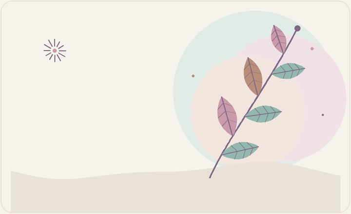
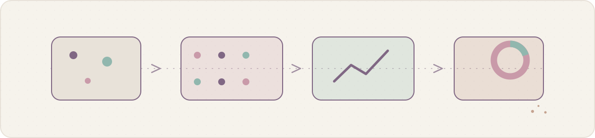
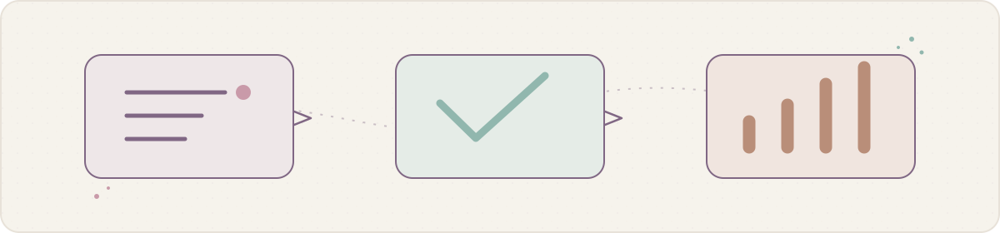

  <table>
    <tr>
      <td width="58%" valign="middle">
        
FIELD NOTES · 01 / ALWAYS LEARNING

        <h1>Kavni Ranpara</h1>
        
<strong>B.Tech CSE · Artificial Intelligence · NSUT</strong>

        
Curious about the systems beneath the surface—and the small ideas that make them clearer.

        
<a href="https://github.com/kavni-29">GitHub</a> &nbsp;·&nbsp; <a href="https://www.linkedin.com/in/kavni-ranpara-b342a9343/">LinkedIn</a>

      </td>
      <td width="42%" align="center" valign="middle">
        
        
<a href="assets/hero/botanical-static.svg">View the still illustration</a>

      </td>
    </tr>
  </table>

LEARNING WITH CURIOSITY · MAKING THINGS WITH CARE

---

## On the worktable

I like exploring how systems work, building practical tools, and making information easier to understand. These two projects reflect that curiosity in different ways.

<table>
  <tr>
    <td width="50%" valign="top">
      
NETWORKS · ANALYSIS

      <h3><a href="https://github.com/kavni-29/netscope">NetScope ↗</a></h3>
      
      
A Python desktop and command-line tool for exploring saved PCAP/PCAPNG captures. It groups packets into bidirectional flows, summarizes endpoints and protocols, applies deterministic explainable anomaly rules, and exports reports.

      
Python · Scapy · Tkinter · Matplotlib · NumPy

    </td>
    <td width="50%" valign="top">
      
RESEARCH · USABILITY

      <h3><a href="https://github.com/kavni-29/USABILITY-HUB-CLONE">Usability Hub Clone ↗</a></h3>
      
      
A Flask research platform for preparing and sharing usability studies, gathering participant responses, and reviewing results through charts and CSV exports. Participants can respond without creating an account.

      
Python · Flask · SQLAlchemy · SQLite / PostgreSQL · HTML · CSS

    </td>
  </tr>
</table>

Illustrations are explanatory diagrams, not product screenshots.

---

## The toolkit, so far

<table>
  <tr>
    <td width="50%" valign="top"><strong>Languages & the web</strong> Python · HTML · CSS</td>
    <td width="50%" valign="top"><strong>Data & network analysis</strong> Scapy · NumPy · Matplotlib</td>
  </tr>
  <tr>
    <td width="50%" valign="top"><strong>Applications & interfaces</strong> Flask · SQLAlchemy · Tkinter / ttk</td>
    <td width="50%" valign="top"><strong>Currently exploring</strong> AI/ML foundations, research methods, and thoughtful ways to make technical information legible.</td>
  </tr>
</table>

## A little beyond code

I enjoy designing clean visuals, writing, and journalling. A notebook is often where a loose question turns into the next thing I want to understand.

  UNTIL THE NEXT NOTE · <a href="https://github.com/kavni-29">GITHUB</a> · <a href="https://www.linkedin.com/in/kavni-ranpara-b342a9343/">LINKEDIN</a>

