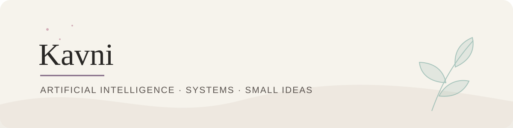

  

# Kavni

**Third-year B.Tech CSE student · Artificial Intelligence · NSUT**

I like getting curious about what happens beneath the interface: how packets move, how data takes shape, and how a useful tool can make a complicated task clearer. I’m also fond of visual design and journalling.

[GitHub](https://github.com/kavni-29) · [LinkedIn](https://www.linkedin.com/in/kavni-ranpara-b342a9343/) · [Instagram](https://instagram.com/kavni29)

---

### Selected work

#### 01 · [NetScope](https://github.com/kavni-29/netscope)

A Python desktop and command-line tool for analysing saved PCAP/PCAPNG captures, summarising network flows, and flagging unusual traffic with explainable rules. It can also monitor a live interface when the capture backend is available, and export reports.

*Python · Scapy · Tkinter · Matplotlib · NumPy*

#### 02 · [UsabilityHub Clone](https://github.com/kavni-29/USABILITY-HUB-CLONE)

A user research app for creating and sharing studies, collecting participant responses, and reviewing results in charts or CSV exports.

*Python · Flask · SQLAlchemy · HTML · CSS*

### Tools in my projects

- **Language:** Python
- **Web:** Flask, HTML, CSS
- **Analysis:** Scapy, Matplotlib, NumPy
- **Interface & data:** Tkinter, SQLAlchemy

NetScope and UsabilityHub are personal projects; their repositories include setup notes and limitations.

---

*Away from the code, I make clean visuals on Canva and keep a journal for stray thoughts and new ideas.*
